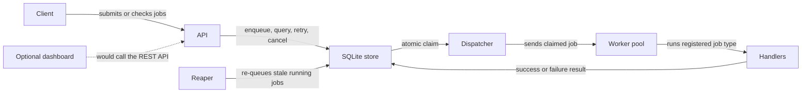

# QueueForge

**A small, persistent background job queue built with Go and SQLite.**

## What this project is

QueueForge is like a restaurant that accepts orders and sends them to several cooks in the kitchen. The cooks work on different orders at the same time, while the restaurant keeps a written record of every order. If a dish fails, the kitchen can try again after a short wait; after too many failures, the order is set aside for someone to inspect. The written record means unfinished orders are still there if the restaurant has to close and reopen.

## What it does

- Accepts jobs over a REST API.
- Processes jobs in parallel with a pool of workers.
- Retries failed jobs with increasing wait times.
- Marks jobs that exhaust their retries as dead.
- Supports high, normal, and low priority jobs.
- Saves jobs in SQLite so they survive crashes and restarts.
- Stops gracefully and gives active work time to finish.
- Limits requests per client.
- Includes a small metrics endpoint and a React dashboard for monitoring and managing jobs.

## Why I built it

Web requests should not have to wait for slow work such as sending email, resizing images, or calling a slow external service. QueueForge keeps that work out of the request path and saves the job so an interruption does not silently lose it.

It also demonstrates how to handle failures safely: retry temporary problems, stop retrying jobs that repeatedly fail, and avoid giving one job to two workers at once.

## Architecture



More detailed diagrams are in [docs/architecture.md](docs/architecture.md).

## Tech stack

| Technology | Use |
|---|---|
| Go 1.22 or newer | HTTP server, worker goroutines, and application logic |
| `net/http` | REST API using Go's standard library |
| `modernc.org/sqlite` | SQLite database without CGO |
| SQLite WAL mode | Durable local storage with concurrent readers |
| React, Vite, TypeScript | Optional browser dashboard |
| `testing` | Unit, API, persistence, and concurrency tests |
| `hey` (optional) | HTTP load testing |

## Quick start

Requirements: Go 1.22 or newer.

```sh
git clone https://github.com/AvniBhardwaj1/QueueForge.git
cd QueueForge
go run ./cmd/queueforge
```

The server listens on port `8080`, starts four workers, and creates `queueforge.db` in the current directory. In another terminal, try:

1. Submit an echo job. Example response (IDs and timestamps will differ):

   ```sh
   curl -sS -X POST http://localhost:8080/jobs \
     -H 'Content-Type: application/json' \
     -d '{"type":"echo","payload":{"message":"hello"}}'
   ```

   ```json
   {"id":"<job-id>","type":"echo","payload":{"message":"hello"},"priority":1,"status":"queued","attempts":0,"max_attempts":5,"run_at":"<timestamp>","created_at":"<timestamp>","updated_at":"<timestamp>"}
   ```

2. List the most recent jobs:

   ```sh
   curl -sS 'http://localhost:8080/jobs?limit=10'
   ```

   ```json
   {"jobs":[{"id":"<job-id>","type":"echo","payload":{"message":"hello"},"priority":1,"status":"succeeded","attempts":1,"max_attempts":5,"run_at":"<timestamp>","created_at":"<timestamp>","updated_at":"<timestamp>"}],"limit":10,"offset":0}
   ```

3. Check one job by its ID:

   ```sh
   curl -sS http://localhost:8080/jobs/<job-id>
   ```

   ```json
   {"id":"<job-id>","type":"echo","payload":{"message":"hello"},"priority":1,"status":"succeeded","attempts":1,"max_attempts":5,"run_at":"<timestamp>","created_at":"<timestamp>","updated_at":"<timestamp>","result":{"message":"hello"}}
   ```

4. See the queue totals:

   ```sh
   curl -sS http://localhost:8080/stats
   ```

   ```json
   {"counts":{"succeeded":1},"jobs_per_minute":1,"average_duration_ms":0.5}
   ```

The job list may show `queued` or `running` if it is checked before a worker finishes. Set `PORT`, `WORKERS`, `POLL_INTERVAL`, and `DB_PATH` as environment variables to change the defaults. Flags such as `-port` and `-workers` are also available.

### Run the dashboard

Start the Go API as above, then open a second terminal:

```sh
cd QueueForge/dashboard
npm ci
npm run dev
```

Open [http://127.0.0.1:5173](http://127.0.0.1:5173). The Vite development server forwards `/jobs` and `/stats` requests to the Go API on port `8080`.

## API reference

Errors use a consistent JSON shape: `{"error":{"code":"...","message":"..."}}`.

| Method | Path | Purpose |
|---|---|---|
| `POST` | `/jobs` | Add a job with `type`, `payload`, and optional `priority`, `max_attempts`, and `delay_seconds`. |
| `GET` | `/jobs/{id}` | Get one job by ID. |
| `GET` | `/jobs` | List jobs; filter with `status` and `type`, and page with `limit` (default 50, maximum 200) and `offset`. |
| `POST` | `/jobs/{id}/retry` | Re-queue a failed or dead job and reset its attempt count. |
| `DELETE` | `/jobs/{id}` | Cancel a job only while it is queued. |
| `GET` | `/stats` | Get counts by status, jobs created in the last minute, and average successful job duration. |
| `GET` | `/healthz` | Check that the HTTP server is responding. |
| `GET` | `/metrics` | Get Prometheus-format queued, running, succeeded, and dead job counts. |

Built-in job types are `echo`, `sleep` (payload example: `{"seconds":1}`), and `flaky`. Priorities are `0` (high), `1` (normal), and `2` (low). Request bodies are limited to 1 MiB.

## Design decisions

- **Why SQLite:** it keeps the project easy to run—there is no separate database service to install. SQLite WAL mode helps readers work while the queue is being updated, and the `queue.Store` interface keeps the storage boundary replaceable.
- **How a job is claimed:** one SQL update selects the best eligible queued job and changes it to running in the same statement. Because selection and status change happen together, two workers cannot both claim that same queued row.
- **How retries work:** after a failure, the worker calculates a growing delay (2 seconds, 4 seconds, then 8 seconds, up to 5 minutes, plus up to 20% random jitter). The job is returned to the queue until its attempt limit is reached, when it becomes dead.
- **How crash recovery works:** workers refresh a running job's lock while they work. At startup and every 30 seconds, the reaper puts jobs with locks older than two minutes back in the queue.

## Limitations and how I would scale it

This version is designed for one machine: the API, dispatcher, and workers run in one process, and SQLite is a local database. The dispatcher polls the database, so work can wait up to the poll interval before it is noticed. The dashboard is a development UI; it is not bundled or served by the Go API.

For several machines, I would replace SQLite with PostgreSQL and claim jobs using `SELECT ... FOR UPDATE SKIP LOCKED`, run workers as multiple processes, and use push notifications instead of polling. A shared rate-limit store would also be needed across API instances.

## Testing and load test results

Run the test suite, race detector, and static checks:

```sh
go test ./...
go test -race ./...
go vet ./...
```

The optional load test requires `hey` and `curl`:

```sh
make load-test
```

Build the optional dashboard for production with:

```sh
cd dashboard
npm ci
npm run build
```

In one run, 1,000 `POST /jobs` requests at concurrency 20 all returned HTTP 201, and four workers completed all 1,000 jobs. `hey` measured **7,080.83 HTTP requests/second**; the load script measured **1,847.75 completed jobs/second over 0.541 seconds**. Machine: **Apple M2, macOS 27.0.1, Go 1.27.3, `hey` 0.1.5**. This is one local run, not a statistically controlled benchmark; results vary by machine and load.

## Project structure

```text
QueueForge/
├── cmd/queueforge/main.go       # Configuration, wiring, and shutdown
├── internal/
│   ├── api/                     # HTTP handlers and middleware
│   ├── backoff/                 # Retry delay calculation
│   ├── queue/                   # Job model and store interface
│   ├── ratelimit/               # Per-client token bucket
│   ├── store/sqlite/            # SQLite implementation and store tests
│   └── worker/                  # Dispatcher, worker pool, and handlers
├── docs/                        # Architecture and codebase guide
├── dashboard/                   # Optional React + Vite + TypeScript UI
├── scripts/                     # Load-test script
├── Makefile
├── go.mod
└── README.md
```
