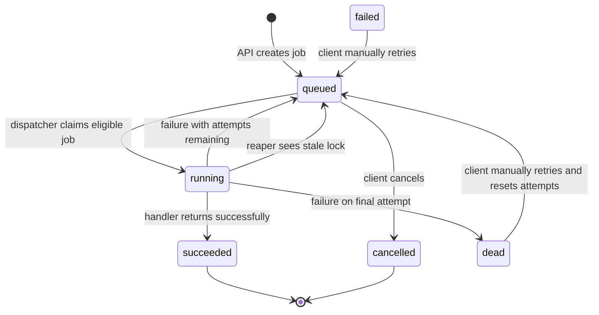

# QueueForge codebase guide

## Big picture

1. The HTTP API validates incoming job requests and asks the store to save them.
2. SQLite keeps each job and its current status on disk.
3. A dispatcher regularly asks SQLite for one eligible job and atomically marks it running.
4. A worker calls the handler registered for that job type and saves success or failure.
5. On shutdown or restart, workers drain where possible and stale running jobs are put back in the queue.

## File-by-file map

| File path | What it does | Key functions/types in it | Who calls it |
|---|---|---|---|
| `cmd/queueforge/main.go` | Reads configuration, connects the API/store/workers, starts background maintenance, and coordinates shutdown. | `main`, `loadConfig`, `runReaper`, `cleanupLimiter`, `config` | Executed by `go run ./cmd/queueforge`; `main` wires the internal packages. |
| `internal/api/api.go` | Registers HTTP routes, validates JSON, returns responses, and wraps routes with logging, CORS, and rate limiting. | `API`, `New`, `Handler`, `createJob`, `getJob`, `listJobs`, `retryJob`, `cancelJob`, `stats`, `metrics`, middleware helpers | `main` constructs `API` and passes `Handler()` to `http.Server`. |
| `internal/api/api_test.go` | Exercises API creation, validation, reads, and not-found behavior with `httptest`. | `newTestAPI`, `TestCreateGetListAndValidation`, `TestCancelUnknownJobReturnsNotFound` | `go test` runs it. |
| `internal/backoff/backoff.go` | Calculates a capped exponential delay with positive jitter. | `Delay` | `worker.Pool.fail` calculates a retry's next `run_at`. |
| `internal/backoff/backoff_test.go` | Checks the backoff formula and cap using fixed jitter values. | `TestDelay` | `go test` runs it. |
| `internal/queue/job.go` | Defines the job, its status values, list filters, stats result, and shared errors. | `Job`, `Status`, `Filter`, `Stats`, `ErrNotFound`, `ErrNotCancellable`, `ErrNotRetryable` | API, SQLite store, and worker pool use these shared types. |
| `internal/queue/store.go` | Defines the storage contract used by the rest of the application. | `Store` | `main` passes the SQLite implementation to the API, worker pool, and reaper. |
| `internal/ratelimit/limiter.go` | Implements a mutex-protected token bucket and idle-bucket cleanup. | `Limiter`, `New`, `NewWithClock`, `Allow`, `Cleanup` | API middleware calls `Allow`; `main` periodically calls `Cleanup`. |
| `internal/ratelimit/limiter_test.go` | Tests token refill and cleanup with an injected clock. | `TestLimiterRefillsAndCleans` | `go test` runs it. |
| `internal/store/sqlite/store.go` | Opens SQLite, creates schema/indexes, and implements job persistence and state changes. | `Open`, `Insert`, `Get`, `List`, `Claim`, `Heartbeat`, `Complete`, `Fail`, `Retry`, `Cancel`, `Reap`, `RequeueRunning`, `Stats` | `main` creates it; API and worker packages call it through `queue.Store`. |
| `internal/store/sqlite/store_test.go` | Checks state changes, priorities, reaping, persistence after reopen, and unique concurrent claims. | `TestRetryAndCancelTransitions`, `TestClaimPriorityAndReap`, `TestJobPersistsAfterReopen`, `TestConcurrentClaimsAreUnique` | `go test` runs it against temporary SQLite databases. |
| `internal/worker/handlers.go` | Defines the handler function shape and the built-in demo job types. | `HandlerFunc`, `DemoHandlers` (`echo`, `sleep`, `flaky`) | `main` creates the registry and passes it to the API and worker pool. |
| `internal/worker/pool.go` | Runs the polling dispatcher, worker goroutines, timeout execution, heartbeats, and result/failure handling. | `Pool`, `NewPool`, `Start`, `dispatch`, `runWorker`, `process`, `heartbeat`, `fail`, `StopClaims`, `Wait`, `CancelWork` | `main` starts and drains the pool; the pool calls the store and handlers. |
| `internal/worker/pool_test.go` | Tests successful handler results and safely handled handler panics. | `TestProcessSuccessAndHandlerPanicRetry` | `go test` runs it. |

## Request and job lifecycle

### A. Submitting a job with `POST /jobs`

1. `main.main` constructs `api.API` and gives `API.Handler()` to the `http.Server`.
2. `API.Handler` registers `POST /jobs` to `API.createJob`.
3. The middleware checks the client's rate-limit bucket, then request logging wraps the handler.
4. `API.createJob` caps the body at 1 MiB, rejects unknown JSON fields, checks that the type exists in the handler registry, validates payload JSON, priority, delay, and attempts.
5. It builds a `queue.Job` with initial `queued` state and calls `Store.Insert` using the request context.
6. `sqlite.Store.Insert` generates a UUID, supplies defaults, and inserts the row into SQLite.
7. The API returns HTTP `201` and the created job as JSON.

Related files: `internal/api/api.go`, `internal/queue/job.go`, and `internal/store/sqlite/store.go`.

### B. A worker picks up and completes the job

1. `main.main` constructs and starts `worker.Pool`; `Pool.Start` starts a dispatcher and the configured number of workers.
2. `Pool.dispatch` calls `Store.Claim` and waits for the next polling tick when there is no eligible work.
3. `sqlite.Store.Claim` uses one `UPDATE ... WHERE id=(SELECT ... ORDER BY priority, created_at LIMIT 1) RETURNING ...` statement. It selects only queued jobs whose `run_at` has arrived and updates the chosen row to `running` while increasing `attempts`.
4. The dispatcher sends the returned job over `Pool.jobs` to a worker's `Pool.runWorker`.
5. `Pool.process` finds the job's handler by type, starts a timeout context, and runs the handler with panic recovery. `Pool.heartbeat` refreshes the lock for long-running work.
6. On success, the worker JSON-encodes the result and calls `Store.Complete`; SQLite marks the row `succeeded` and saves the result.
7. The client can retrieve that result using `GET /jobs/{id}`.

Related files: `internal/worker/pool.go`, `internal/worker/handlers.go`, and `internal/store/sqlite/store.go`.

### C. A job fails, retries, or becomes dead

1. If a handler returns an error, panics, or its result cannot be JSON-encoded, `Pool.process` calls `Pool.fail`.
2. `Pool.fail` compares the already-incremented attempt count to `max_attempts`. If the limit is reached, it requests the `dead` state; otherwise it requests `queued`.
3. `Pool.fail` calls `backoff.Delay` to compute the next available time. The base is 2 seconds, it doubles per attempt up to 5 minutes, and random positive jitter can add up to 20%.
4. `sqlite.Store.Fail` saves the error, sets the chosen status and `run_at`, and clears the running lock. A retry is later eligible for `Store.Claim`; a dead job can be manually restarted with `POST /jobs/{id}/retry`.
5. The manual retry calls `sqlite.Store.Retry`, which accepts `failed` or `dead`, resets attempts to zero, clears old error/result data, and queues the job now.

The `failed` status is supported by the schema and manual retry logic, but the current worker code goes directly from a failure to `queued` or `dead`.

Related files: `internal/worker/pool.go`, `internal/backoff/backoff.go`, and `internal/store/sqlite/store.go`.

### D. The process crashes mid-job and restarts

1. A claimed job is persisted with status `running` and a `locked_at` timestamp.
2. While the handler is active, `Pool.heartbeat` refreshes that timestamp every 30 seconds.
3. When the application starts, `main.main` calls `Store.Reap` before starting workers. `runReaper` calls it every 30 seconds after startup.
4. `sqlite.Store.Reap` finds `running` rows with a lock older than two minutes and returns them to `queued`. A worker that died stops updating its lock; healthy jobs keep their locks fresh.
5. The normal dispatcher then claims the recovered work again. The handler may therefore run again if the process died before recording its result; job handlers should be safe to repeat when possible.

Related files: `cmd/queueforge/main.go`, `internal/worker/pool.go`, and `internal/store/sqlite/store.go`.

### E. Pressing Ctrl+C

1. `signal.NotifyContext` in `main.main` observes Ctrl+C (`SIGINT`) or termination (`SIGTERM`).
2. The main routine calls `Pool.StopClaims`, so the dispatcher stops fetching new jobs and closes the worker channel.
3. `http.Server.Shutdown` stops accepting new requests and allows current requests to finish.
4. The application waits for the worker and dispatcher goroutines for up to 20 seconds. Active handlers keep their timeout contexts and can finish.
5. If that deadline expires, `Pool.CancelWork` cancels handler contexts and `Store.RequeueRunning` returns all remaining running jobs to the queue. After the workers drain normally, it also requeues any final claimed job that was not handed to a worker.
6. The SQLite database is closed as `main` returns. Any remaining queued work is available on the next start.

Related files: `cmd/queueforge/main.go` and `internal/worker/pool.go`.

## Job state machine

`failed` is supported for retry compatibility, but no current worker path sets it.

## Where do I change X?

| Change | File or setting |
|---|---|
| Change the retry base or maximum delay | `internal/worker/pool.go`, in `NewPool` (`baseBackoff` and `maxBackoff`) |
| Change the backoff formula or jitter amount | `internal/backoff/backoff.go`, `Delay` |
| Add a job type | Add a `HandlerFunc` to `worker.DemoHandlers` in `internal/worker/handlers.go`; register its type in that map so API validation accepts it. |
| Change how many workers run | `WORKERS` environment variable or `-workers` flag; defaults and validation are in `cmd/queueforge/main.go`. |
| Change polling frequency | `POLL_INTERVAL` or `-poll-interval` in `cmd/queueforge/main.go`. |
| Change per-client request rate and burst | `RATE_LIMIT_PER_SEC` / `-rate-limit` and `RATE_LIMIT_BURST` / `-rate-burst`; defaults are wired in `cmd/queueforge/main.go`. |
| Change job timeout | `JOB_TIMEOUT` or `-job-timeout` in `cmd/queueforge/main.go`. |
| Change HTTP input validation or routes | `internal/api/api.go`. |
| Change job schema or SQL operations | `internal/store/sqlite/store.go`; keep the `queue.Store` interface in sync. |
| Change stale-lock age or reaper frequency | `cmd/queueforge/main.go`, calls to `Store.Reap`. |

## Glossary

- **Goroutine:** A lightweight unit of work Go can run concurrently. QueueForge runs multiple worker goroutines.
- **Channel:** A typed communication path between goroutines. The dispatcher sends claimed jobs to workers through a channel.
- **Context:** A value passed through a call chain to carry cancellation and deadlines. Each handler receives a timeout context.
- **WaitGroup:** A counter used to wait until a group of goroutines has finished. The pool uses one to drain workers on shutdown.
- **Token bucket:** A rate limiter with a bucket of request tokens that refill over time. A request uses one token or is rejected.
- **Exponential backoff:** A retry wait that grows by a multiplier (here, doubles) after repeated failures, up to a maximum.
- **WAL mode:** SQLite's write-ahead log mode. Changes are recorded in a log first, which allows readers to keep working while writes occur.
- **Dead-letter queue:** A place for jobs that exhausted their retries. QueueForge represents this with the `dead` job status.

## Questions I should be able to answer in interviews

**How does the code claim a job atomically?** It uses one SQLite `UPDATE` statement that selects the next eligible queued row and marks it `running` before returning it. The selection and state change are one database operation.

**What happens if a worker crashes?** Its lock heartbeat stops. At startup and every 30 seconds, the reaper re-queues running jobs whose lock has been stale for two minutes.

**How does it prevent two workers from processing the same queued row?** A claim changes that row from `queued` to `running` atomically. Later claim statements only select rows still marked `queued`.

**How would I scale to multiple machines?** Replace local SQLite with shared PostgreSQL, claim with `SELECT ... FOR UPDATE SKIP LOCKED`, run workers in multiple processes, and share rate-limit state.

**How does graceful shutdown work?** It stops claims, shuts down HTTP, waits up to 20 seconds for existing workers, then cancels contexts and re-queues anything still running.
