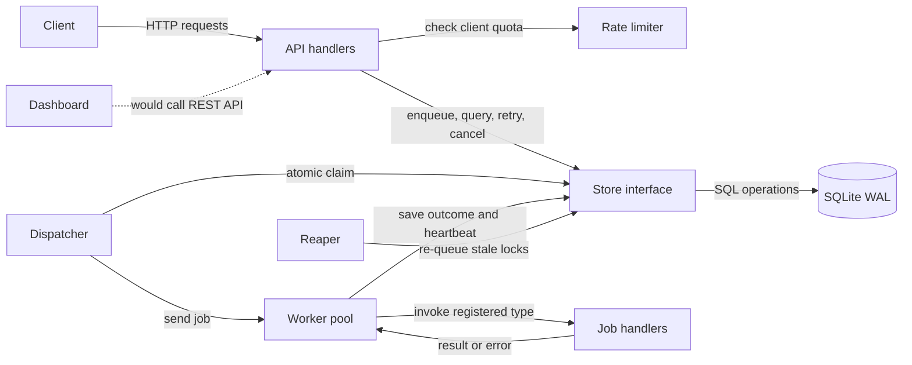
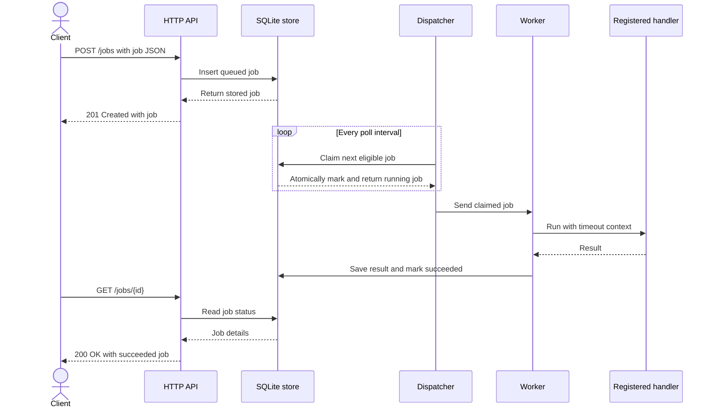
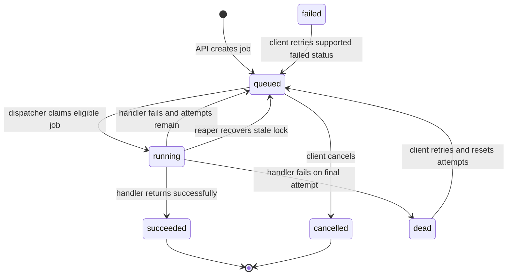

# QueueForge architecture

These diagrams describe the code as it is implemented. `failed` is a supported database/API status that can be manually retried, but the current worker sends failures straight back to `queued` or marks them `dead`.

## Components

## Job submission and execution

## Job state machine

`failed` is reserved for compatibility with the retry endpoint; there is no current code path that sets a job to `failed`. Handler failures go directly to `queued` (retry) or `dead` (attempts exhausted).
